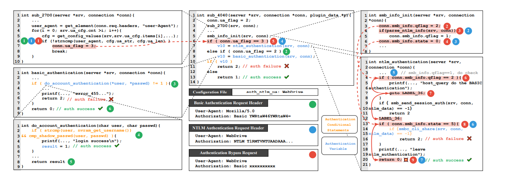
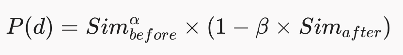

https://www.ndss-symposium.org/ndss-paper/through-the-authentication-maze-detecting-authentication-bypass-vulnerabilities-in-firmware-binaries/

 
선정 논문: Through the Authentication Maze

게재 학회 및 연도: Network and Distributed System Security (NDSS) Symposium 2026   

저자: Nanyu Zhong, Yuekang Li, Yanyan Zou, Jiaxu Zhao, Jinwei Dong, Yang Xiao, Bingwei Peng, Yeting Li, Wei Wang, Wei Huo (Chinese Academy of Sciences, University of New South Wales)

논문 선정이유

논문을 보는게 처음이기 때문에 논문들 제목들을 전부 보고 관심이 가는 다섯가지로 추렸는데 그 중 이 논문이 제일 보안쪽 중심적인 내용을 다루는 제목인것 같아서 이 논문을 이해하면 보안관련 지식을 쌓을 수 있을까 라는 기대를 가지고 읽게되었음.
   

논문읽기 전 질문
 
1. 이 논문이 다루는 문제가 무엇인가?
 
읽기 전: 공유기 같은 기기 안에 있는 기본 소프트웨어인 펌웨어에서 원래라면 비밀번호를 입력해야 통과할 수 있는 인증장치를 우회하여 찾아내는 문제인것 같다.
 
읽은 후: 로그인 화면 우회뿐만이 아니라, 로그인한 뒤 관리자 기능을 사용할 때 매번 확인하는 세션쿠키나 토큰 검증을 건너뛰는 공격까지 다룬다.
   
2. 왜 이 문제가 중요한가?
 
읽기 전: 비밀번호를 사용하는 페이지에 대해서 아무래도 안그런 페이지에 비해 신뢰성을 가질 수 있는데, 비밀번호 설정이 소용없다는 점은 프로그램에 대한 신뢰성문제에 크게 영향을 끼칠 수 있을거 같음. 특히 펌웨어는 기계를 움직이는 가장 기본적이면서 핵심적인 소프트웨어이기 때문에 뚫리게 된다면 그에 대한 피해가 클것같다.
 
읽은 후: 임베디드 기기의 경우 관리 웹 페이지는 공용 네트워크에 그대로 노출되는 경우가 많은데, 인증 우회가 한 번 뚫리게 되면 해커가 관리자 권한으로만 접근할 수 있는 내부 시스템 셸을 따내거나 다른 심각한 취약점들을 연쇄적으로 터뜨릴 수 있기 때문에 파급력이 크다.
   
3. 기존 방식들은 무엇이 부족했는가?
 
읽기 전: 바이너리와 미로라는 표현을 통해 사람이 이해하기 쉬운 소스코드가 아니라는 어려움과 미로같은 복잡함이 존재하는것 같다.
 
읽은 후: 기존 도구들은 사람의 감 즉 휴리스틱 부분과 특정 단어를 탐지해내는데에 너무 의존했다는 점이 제일 큰 문제이다. 예를들어 Firmalice는 코드중에 login success같은 문구를 찾는데에 중점을 두었지만 요즘 기기들은 그런 문구를 직접적으로 사용하지 않거나, 여러 인증 방식을 섞어 사용하기 때문에 기존 방식으로는 발견하지 못한다.
  

1. 이 논문의 배경 및 문제 정의
   
1.1 임베디드 웹 서비스의 인증 구조와 위협 모델
 
현대의 라우터, NAS, 게이트웨이 등 임베디드 시스템은 원격 제어를 위해 경량 웹 서버를 내장하며, 주로 토큰 기반 인증 워크플로우를 사용한다.
   
-사용자 자격 증명: 로그인 단계에서 클라이언트가 id/password, pin등을 제출하면 서버가 이를 검증하고 액세스 토큰을 발급한다.
   
-토큰 자격 증명: 이후 보호된 리소스에 접근할때 클라이언트가 쿠키, JWT, 세션id등의 토큰을 제시하면 서버가 이를 검증한다.
   

저자들은 공격자가 유효한 자격 증명 없이 임의의 HTTP 요청을 조작해 보낼 수 있는 상황을 가정하고, 공격 벡터를 두 가지로 명확히 정의했다
   
-Attack Vector 1: 로그인 핸들러에서 사용자 자격 증명 검증을 우회하여 정당한 액세스 토큰을 탈취하는 공격.   

-Attack Vector 2: 보호된 리소스 요청 핸들러에서 토큰 자격 증명 검증을 우회하여 관리자 기능에 직접 접근하는 공격.
   1.2 실제 사례(CVE-2025-2492)로 본 기존 기법의 구조적 한계
   
저자들은 연구의 동기를 설명하기 위해 실제 장비(ASUS RT-AC68U 등)의 lighttpd 기반 웹 서비스에서 발견한 CVE-2025-2492 취약점을 예시로 제시한다. 이 백엔드 바이너리는 설정 파일과 요청의 User-Agent 헤더에 따라 Basic 인증과 NTLM 인증 두 가지 루틴을 모두 지원한다.
   

 
취약점 발생 원리:공격자는 요청 헤더의 User-Agent를 NTLM용인 WebDrive로 맞추고, Authorization 헤더는 Basic 인증용 데이터로 섞어서 보냈다. 이 조작된 요청을 받은 백엔드는 두 개의 독립적인 변수를 다르게 처리하며 오작동을 일으킨다. 첫째, User-Agent를 확인하는 함수는 인증 방식을 결정하는 변수(ua_flag)를 3(NTLM)으로 바꾼다. 하지만 둘째, 헤더 내용을 파싱하는 함수는 데이터가 NTLM 형식이 아니기 때문에 상태를 나타내는 변수(smb_info.qflag)를 성공 상태(1)로 바꾸지 못하고 초기값(2)으로 내버려 둔다. 결국 실행 흐름이 NTLM 검증 함수로 넘어가지만, 이 함수는 qflag가 2인 것을 보고 "이건 내가 처리할 게 아니라 Basic 인증 함수가 처리할 데이터구나"라고 착각해 검사를 아예 건너뛰어 버린다(goto LABEL_36). 두 인증 루틴이 서로 책임을 떠넘기는 로직의 빈틈을 파고든 것이다. 기존의 도구들은 복수의 인증이 얽혀 있는 이러한 구조를 추적하지 못하고 최상위 라우팅 함수만 찾거나 특정 단어(login success 등)만 찾아 헤매다가 진짜 검증 로직을 놓쳐버리고 만다. 프로그램이 뻗어버리는 크래시(Crash)가 나지 않으니 기존 퍼징 도구로는 탐지할 방도가 없었던 것이다.

   
기존 연구들이 실패하는 이유:

1) Firmalice (NDSS 2015): "login success" 같은 고정된 문자열 단서나 수동 정책에 의존해 인증 코드를 찾는다. 따라서 문자열 단서가 없는 NTLM 인증 루틴의 취약점은 아예 인식하지 못한다.   

2) Weasel (CCS 2013): 실행 트레이스로부터 의사결정 트리를 만들고 지배자 노드를 인증 함수로 추정하는 휴리스틱을 쓴다. 하지만 위 사례처럼 복수의 인증 메커니즘이 얽혀 있으면 최상위 라우팅 함수 하나만 찾고 실제 검증 함수들은 놓치게 된다.
   
위의 내용들을 보았을때 프로그램이 아예 뻗어버리는 crash 버그와 달리, 인증 우회라는 것은 작동은 멀쩡히 하면서 권한만 뚫어버리는 논리 버그이기 때문에 기존 도구들로는 어디가 통과구역인지 조차 찾지 못할 수 밖에 없다는 점을 이해할 수 있었다.

   
2. 핵심 아이디어 및 시스템 구성-AuthSpark는 어떻게 문제를 해결했는지
   

논문의 해결책을 살펴보기 전, AuthSpark 프레임워크가 취약점을 찾아내기 위해 사용하는 고유의 개념과 기호들을 먼저 정리하였음.
  

| 용어 및 기호 | 풀네임 | 개념 정의 및 본 논문에서의 역할 |
| --- | --- | --- |
| CVS | Credential Verification Statement (자격 증명 검증문) |자격 증명의 유효성을 최초로 검사해 성공/실패 흐름을 가르는 핵심 조건문 (예: 비밀번호 비교 if문) |
|AV ($$\mathcal{V}_{auth}$$)| Authentication Variable (인증 변수) | CVS의 검증 결과(성공/실패 여부)를 담아 다른 변수나 함수 반환값으로 전달하는 인증 변수 |
| ACS($$\mathcal{C}_{auth}$$) | Authentication Conditional Statement (인증 조건문) |전파된 AV 값을 바탕으로 성공/실패 경로를 결정하는 모든 인증 조건문의 집합 (CVS가 그 출발점임) |
| ASBB($$\mathcal{B}_{succ}$$) | Authentication-Success Basic Block (인증 성공 기본 블록)|인증 검사를 무사히 통과해야만 실행되는 인증 성공 기본 블록 (퍼저가 최종적으로 뚫고 들어가야 할 타겟) |
| AFBB($$\mathcal{B}_{fail}$$) | Authentication-Failure Basic Block (인증 실패 기본 블록) | 인증 실패 시 실행되는 인증 실패 기본 블록 (나중에 숨겨진 인증 조건문을 역추론할 때 단서가 됨)   |

  
2.1 저자들의 두가지 핵심 관찰과 통찰
 
저자들은 인증 메커니즘이 아무리 다양하더라도 모든 인증 우회 취약점의 본질은 "적절한 자격 증명 검사를 거치지 않고 인증 성공 상태 코드에 도달하는 실행 경로가 존재하는 것"이라는 점에 주목하여 두 가지 규칙성을 발견했다.
   
관찰 1 (실행 트레이스의 분기 특성): 인증 성공 요청과 인증 실패 요청의 실행 트레이스(Execution Trace)를 비교하면, 자격 증명을 검증하는 조건문인 CVS(Credential Verification Statement) 이전까지는 전처리 및 플래그 설정 등으로 인해 실행 경로가 매우 유사하지만, CVS 직후부터는 실패 요청이 조기 종료되는 등 경로가 급격히 갈라진다.
   
관찰 2 (인증 변수의 전파 특성): CVS에서 판별된 인증 결과는 특정 변수인 AV에 저장되며, 이 변수는 상위 호출 함수의 반환값으로 전달되거나 이후 코드 흐름으로 전파되면서 최종적으로 ASBB의 실행 여부를 통제한다.
   
2.2 AuthSpark의 4단계 파이프라인 아키텍처
   
1단계: 전처리 및 의사코드 정렬(preprocessing)
 
쌍 요청 입력 및 동적 계측: 정상 자격 증명을 가진 성공 요청과, 자격 증명이나 토큰 필드만 더미 값으로 변이한 실패 요청 한 쌍을 준비, 다른 필드는 고정하고 인증필드만 바꿈으로써 실행 트레이스의 차이가 오직 인증 검증에서만 기인하도록 통제한다. 이후 QEMU 기반 동적 계측을 통해 두 요청의 기본 블록 실행 트레이스 수집.
 
trace-to-pseudocode alignment: 어셈블리 수준에서는 변수 및 문장 단위 데이터 흐름 분석이 어렵기 때문에, 수집된 동적 트레이스를 IDA pro의 디컴파일러가 생성한 의사코드 수준에 매핑, 이때 멀티스레딩 등에 의한 흐름꼬임을 방지하기 위해 콜스택 컨텍스트를 복원하여 문맥이 유지된 의사코드 트레이스를 만들고, 함수별 CDG와 DDG구축
   
2단계: 자격 증명 검증문 탐지
 
-콜스택 기반 분할 정복 LCS: 성공.실패두 트레이스가 갈라지는 분기점을 찾기 위해 최장 공통 부분 수열 알고리즘을 사용한다. 그러나 수만 개의 기본 블록으로 이루어진 원본 트레이스에 LCS를 바로 적용하면 계산 복잡도가 폭발한다. 이를 해결하기 위해 함수 호출 지점의  튜플 시퀀스에 먼저 LCS를 적용해 정렬 지점을 찾고, 트레이스를 작은 세그먼트로 쪼갠 뒤 구간별 LCS를 수행하는 최적화를 도입했다.
 
-유사도 스코어링 수식: 추출된 후보 분기점 d 중 실제 CVS를 가려내기 위해 
Ratcliff/Obershelp알고리즘으로 분기점 이전의 유사도와 이후의 유사도를 계산하여 다음 점수를 매긴다.
   

   

여기서 α (실험 최적값 3)는 분기 이전 경로가 동일할수록 보상을 증폭하는 지수이고, β (실험 최적값 0.2)는 분기 이후 경로가 비슷할 때 페널티를 주는 가중치다. 이 수식을 통해 "이전까지는 똑같이 실행되다가 이 지점 직후부터 완전히 달라지는" CVS를 정확히 1순위로 랭크한다.
   
3단계: 인증 성공 기본 블록 식별
   
식별된 CVS를 출발점으로 삼아, 함수 간 반복적 순방향 데이터 흐름 분석을 수행하여 인증 변수 집합, 인증 조건문 집합, 인증 성공/실패 블록 집합을 확장해 나간다.
   
-인증 변수 생성 3대 규칙
  
1. 제어 의존성 조건: 변수 대입문의 제어 의존성이 오직 동일한 인증 결과를 갖는 인증 조건문들의 부분집합에만 종속될 때 해당 변수를 AV로 마킹한다.
 
2. 복사 전파 조건: 기존 AV의 값을 그대로 대입받는 변수는 동일한 인증 상태를 상속받는다.
 
3. 함수 반환 변수 조건: return 문이 AV를 반환하거나 인증 조건문에 제어 의존성을 가질 때, 성공 맥락과 실패 맥락에서의 반환값을 평가하여 두 값이 다르면 해당 함수의 반환값 자체를 AV로 등록한다.
   

-인증 조건문 및 블록 업데이트 2대 규칙
 
1. 변수 기반 식별: 조건문이 $$\mathcal{V}_{auth}$$에 속한 변수만 참조한다면, SMT 솔버를 이용해 해당 변수의 값에 따라 어느 분기가 인증 성공인지 추론한다.
 
2. 동적 트레이스 기반 식별: 조건문이 명시적인 AV를 쓰지 않더라도, 성공 트레이스에서 선택되지 않은 반대쪽 분기가 이미 확인된 실패 블록으로 직행한다면 암묵적 인증 조건문으로 추론하여 추가한다.
이후 기본 블록의 첫 문장이 $$\mathcal{C}_{auth}$$의 성공 분기에 제어 의존성을 가지면 최종적으로 목표 타겟인 ASBB($$\mathcal{B}_{succ}$$)에 편입시킨다.
   

4단계: 우회 경로 마이닝 및 검증
   
찾아낸 모든 성공 블록들을 타겟으로 삼아 다중 타겟 지향성 그레이박스 퍼징 수행
   
-3가지 가이드 전략: 
  
(1) 새로운 엣지 발견 비율을 뜻하는 Coverage Score
 
(2) 테스트 케이스 실행 경로에서 각 성공 블록까지의 제어 흐름 거리를 가중 평균한 Distance Score
 
(3) 문자열 가이드 변이 생성을 결합한다. 특히 임베디드 웹 서버는 헤더나 파라미터를 strcmp, strncmp, strstr 같은 문자열 비교 함수로 검사하는 경우가 많으므로, 런타임에 이 함수들의 인자를 후킹해 설정 파일에서 로드된 문자열을 사전에 추가하고, 타겟 도달을 가로막는 핵심 분기가 발견되면 SMT 솔버로 그 문자열 비교를 통과할 입력값을 계산해 변이에 직접 주입한다.
   
-검증모듈: 통합 인증 구조를 가진 서버에서는 로그인이나 인증이 원래 필요 없는 공개 엔드포인트도 동일한 인증 함수를 거쳐 $$\mathcal{B}_{succ}$$에 도달하므로 다수의 오탐이 발생할 수 있다. 이를 막기 위해 $$\mathcal{B}_{succ}$$에 도달한 입력이 나오면 URL 정규화 후 유효한 자격 증명을 넣은 요청과 무효한 자격 증명을 넣은 요청 두 개를 만들어 서버 응답을 비교한다. 두 응답이 똑같다면 원래 공개된 페이지이므로 필터링하고, 응답이 다를 때만 보호된 엔드포인트가 뚫린 실제 취약점으로 최종 확정한다.
   
위의 내용들을 통해 맞는 요청과 틀린 요청들을 동시에 실행하여 경로가 갈라지게되는 검문소 역할인 CVS를 찾아내고, 검문 결과가 흘러가는 변수를 따라가 통과구역인 ASBB를 표시해둔 뒤, 그 구역만 집중적으로 노려서 우회경로를 찾아낸다는 것이 제일 큰 틀인것 같다. 과정에 대해서는 콜스택 기반 분할 정복 기법을 사용하여 수만줄 짜리 실행 기록을 통째로 비교하기보다, 함수가 호출되는 큰 단위로 쪼개고 그 다음에 세밀하게 비교함으로써 걸리는 시간을 줄이는 전처리 단계를 적용하였고, 유사도 스코어링 공식을 통해 cvs에 오기까지는 큰 차이가 없다가, 지나는 순간 둘 중 하나는 통과하고 하나는 통과하지 못하면서 이후의 과정이 아예 달라진다는 점을 구분해낸것이 흥미로웠다. 이후에 cvs에서 발급한 av가 어떤 변수를 타서 다른 함수로 넘어가는지를 추적하여 ASBB들의 위치를 찾아내어 표시를 해둘 수 있다는 점, Distance Score를 이용하여 ASBB까지에 대한 최단 거리로 파고들고, 그 사이에 비밀번호나 특정 단어를 요구하는 인증 절차가 나오면 SMT솔버 같은 도구를 이용하여 통과 할 수 있다는 점을 알 수 있었음.

    
3. 실험 평가, 실제 성과 및 한계점
   
3.1 실험 환경 및 데이터셋 구성

저자들은 약 25,000줄의 Python과 3,000줄의 C 코드로 AuthSpark를 구현했다. 평가는 D-Link, TP-Link, Fortigate, F5, Ivanti, QNAP, NETGEAR, Zyxel, ASUS, Linksys 등 12개 제조사의 실제 장비 펌웨어 32종을 대상으로 진행되었으며, 여기에는 14개의 알려진 취약점이 포함되어 있다. 에뮬레이션 한계를 보완하기 위해 22개 장비는 QEMU 계측(dataset-1)으로, 나머지 10개 장비는 GDB 트레이싱(dataset-2)으로 실행 트레이스를 수집했다.
   
3.2 핵심 실험 결과(RQ1 ~ RQ3)

  

| 평가 항목 (Research Question) | 비교 대상 / 설정 | 핵심 실험 결과 및 수치 |
| --- | --- | --- |
| RQ1-1: CVS(자격 증명 검증문) 식별 정확도| AuthSpark vs Weasel (총 44개 실제 CVS 대상, Top-1 기준)| AuthSpark: 44개 중 42개(95.5%) 정확히 Top-1 식별 (Top-4 기준 44개 전수 식별), 알려진 취약점 14개와 연결된 핵심 CVS 11개 100% 식별.  Weasel: 44개 중 **16개(36.4%)**만 식별, 취약점 관련 CVS는 11개 중 3개만 탐지. |
| RQ1-2: ASBB(인증 성공 블록) 식별 절제 연구 | Full AuthSpark vs 규칙별 제거 모델 4종 (NoCopy, NoFunc, NoVarCond, NoDynamicCond) | Full AuthSpark: 총 383개 ASBB 식별, 14개 1-day 취약점 경로 100%(14/14) 노출. 복사 전파 제거(NoCopy): 230개 식별 (취약점 4개만 노출). 함수 반환 변수 제거(NoFunc): 132개 식별 (취약점 1개만 노출 — 이 규칙을 제외하면 14개의 취약점 중 단 1개만 찾아낼 수 있으므로, 함수 반환값을 통한 상태 전파가 추적 과정에서 가장 중요한 핵심 규칙임을 입증). 변수 기반 조건문 제거(NoVarCond): 77개 식별 (취약점 2개만 노출). 동적 트레이스 조건문 제거(NoDynamicCond): 363개 식별 (1-day는 모두 찾았으나 실제 0-day 1건(Report Issue 1) 미탐지).|
| RQ2: 1-day 취약점 퍼징 탐지 성능 (QEMU 지원 22개 장비, 24시간×5회)| AuthSpark vs 변이 제거 모델 2종 vs 기존 퍼저 3종 (SRFuzzer, Snipuzz, BooFuzz) |AuthSpark: 대상 장비 내 알려진 1-day 9개 전수(9/9) 탐지 및 0-day 6개 발굴 (기술 문서가 없던 NETGEAR XR300의 CVE-2021-34977도 URL 내 "rpc" 문자열 조건을 역산해 재발견). AuthSpark-NoStr(동적 문자열 제거): 1-day 6개, 0-day 3개 / NoStr-NoMutate: 1-day 3개, 0-day 2개. 기존 퍼저 3종: 이들은 본래 인증 우회용이 아니므로, 거리 점수나 문자열 변이 같은 길잡이 없이 ASBB이 실행됐는지 감시하는 기능(Oracle)만 붙여서 실험함. 그 결과 까다로운 조건을 요구하는 1-day는 0개(0/9)로 모두 놓쳤으나, 상대적으로 접근 경로가 단순한 0-day 2개(Report Issue 1, 5)는 길잡이 없이도 찾아내는 데 성공함.|
| RQ3: 최신 펌웨어 0-day 취약점 발굴 | 최신 버전 펌웨어 대상 퍼징 | 총 6개의 0-day 인증 우회 취약점 신규 발굴 및 제조사 검증 완료 (CVE 3건, PSV 1건 공식 할당: PSV-2025-0044 2건, CVE-2024-6342, CVE-2025-2492, CVE-2025-59366 등). 검증 모듈을 통해 ASUS RT-AX56U에서 24시간 동안 발생한 2,689개의 알림 중 공개 엔드포인트 오탐을 걸러내고 158개로 줄이는 데 성공. |

   
3.3 한계점 및 아쉬운점
   
논문이 자체적으로 언급한 한계
   

1. 극단적으로 긴 실행 트레이스에서의 CVS 랭킹 오류: AuthSpark가 Top-1에서 놓친 2개의 CVS(FortiOS 및 TP-Link Archer C8)를 분석해 보면, 전체 실행 트레이스가 50,000개 이상의 기본 블록으로 매우 길고, 실제 CVS에서 발생한 성공/실패의 분기가 아주 짧게 끝난 뒤 다시 합류하여 긴 공통 경로를 공유하는 구조를 띠고 있었다. 이 경우 트레이스 후반부에 우연히 등장한 무관한 분기점이 앞선 거대한 공통 프리픽스 덕분에 Sim before ≈0.99라는 높은 점수를 받아 실제 CVS를 밀어내고 1순위로 잘못 랭크되는 현상이 발생했다.
 
2. 비전통적 인증 상태 저장소 추적 불가:
AuthSpark는 인증 결과가 메모리 상의 지역/전역 변수나 함수 반환값을 통해 전파된다고 가정한다. 따라서 Juniper SRX처럼 인증 결과를 세션 파일이나 외부 DB, 공유 메모리에 기록해 두고 나중에 파일 내용만 읽어서 검증하는 아키텍처에서는 데이터 흐름이 끊겨 추적하지 못한다.
 
3. 다중 레벨 포인터 및 복합 자료구조에 대한 정적 분석의 한계:
인증 상태가 다중 포인터로 참조되는 복잡한 구조체 필드 내부에 저장될 경우, IDA Pro의 디컴파일러와 정적 데이터 흐름 분석이 기본 블록 너머로 변수 상태를 온전히 전파하지 못하는 정밀도 한계가 존재한다.
 
4. 단일 C/C++ 바이너리 모듈 내 분석으로 제한된 범위: SonicWall GMS처럼 Apache와 Tomcat 등 여러 모듈이나 프로세스에 걸쳐 인증 로직이 분산되어 있거나, PHP/Lua/Python 같은 스크립트 언어로 인증이 구현된 경우 현재의 AuthSpark로는 엔드투엔드 추적이 불가능하다. 또한 QEMU 시스템 에뮬레이션이 실패하여 GDB에 의존해야 했던 10개 장비(dataset-2)의 경우, 트레이스 기반 CVS/ASBB 식별까지는 가능했으나 QEMU 계측에 의존하는 피드백 기반 퍼징 실험에서는 제외되었다.
   
실제 임베디드 장비 32종 중 95.5%라는 높은 정확도로 CVS를 찾아내고 미지의 제로데이 6개를 발굴한 점은 훌륭하다. 다만 비교 실험과 관련하여, 기존 범용 퍼저 3종이 아무런 길잡이 없이도 0-day 2개를 찾아냈다는 점을 고려하면 접근 경로가 단순한 취약점은 길잡이 없이도 찾아질 수 있음을 보여주며, 따라서 인증 우회를 노리는 다른 '지향성 퍼저'와 탐색 성능을 비교하지 않은 점은 설득력 측면에서 아쉬움으로 남는다. 또한, 단순히 소스코드가 길어서 못 찾는 것이 아니라 실행 트레이스가 5만 블록 이상으로 방대하게 길면서, CVS의 분기가 짧게 갈라졌다가 곧바로 다시 합쳐지는 경우 점수가 역전되어 오탐이 발생하는 구조적 한계도 명확히 인지해야 한다.
   
4. 느낀점, 배운점 및 향후 연구/ 프로젝트 확장
   
4.1 느낀점
   
보안에 관련된것이 아니라 논문 자체를 읽어보는것이 처음이었는데 기본지식이 부족하다보니 양이 방대한것은 아님에도 불구하고, 기본적인 단어들의 뜻과 의미조차 몰라 뜻을 검색하고 이해하려고 하는 부분에 있어서 소요된 시간이 오래걸렸던것 같다. 그럼에도 불구하고 내가 이 논문의 정확한 내용을 파악했는지 조차 솔직히 모르겠다, 단어의 의미를 알면 좀 이해하기 쉬울까 라고 생각하였지만 전혀 그렇지 않았다. 그래도 이해하지 못하더라도 이런 논문들을 하나씩 읽어보는것만으로도 보안 용어에 익숙해지고 찾아보는 습관을 기를 수 있을것 같다는 생각을 하게되었다.
   
4.2 논문을 통해 배운점과 인사이트
   
메모리 취약점과 달리 무엇이 버그인지 정의하기조차 막막한 논리 취약점을, 성공/실패 실행 트레이스 간 차분 분석과 정적 제어,데이터 흐름 전파의 결합으로 풀어낸 점이 매우 인상 깊었다. 특히 동적 분석만 쓰면 도달하지 못한 코드 경로의 인증 로직을 놓치기 쉽고, 정적 분석만 쓰면 무엇이 인증 검증문인지조차 특정할 수 없는데, 동적 트레이스 비교로 시작점을 정확히 꽂아준 뒤 정적 분석으로 목표 지점을 확장하고 다시 지향성 퍼징으로 둘 사이의 우회 경로를 뚫어내는 것이 인상적이었다.
   
4.3 앞으로 할 것
   
-논문읽기
  
Atropos: Effective Fuzzing of Web Applications for Server-Side Vulnerabilities (USENIX Security 2024, Güler et al.): AuthSpark의 문자열 비교 함수 후킹 및 동적 문자열 사전 구축에 직접적인 영감을 준 논문이기 때문에 읽으면 AuthSpark라는 것에 대해 지금보다 더 깊게 이해할 수 있을것 같아서 읽어보려한다.
   
-다른 분야에서의 적용 가능성
  
공유기 같은 임베디드 기기뿐만 아니라, 일반 웹사이트처럼 아이디/패스워드나 토큰 인증을 사용하는 웹 서비스에서도 권한 검사가 누락된 취약점을 찾을 때 '성공/실패 실행 흐름 비교' 방식을 동일하게 적용할 수 있을 것 같다. 다만 일반 웹사이트는 대부분 스크립트 언어로 돌아가므로, 바이너리를 분석하는 대신 해당 언어의 인터프리터 수준에서 실행 트레이스를 뽑아내는 과정이 추가로 필요할 것 같다.
   
-직접 구현·재현해 보고 싶은 포인트
 
CVS를 가려낼 때 사용한 유사도 점수 공식($P(d)$)만큼은 파이썬으로 직접 구현해 보고 싶다. 알파(3)와 베타(0.2) 가중치를 적용한 계산 코드를 짜고, 내가 임의로 만든 짧은 알파벳 가짜 트레이스 문자열을 넣었을 때 정말로 경로가 갈라지는 분기점이 1등으로 계산되어 나오는지 테스트해 보면 논문의 핵심 아이디어를 확실히 체감할 수 있을 것 같다.
   
-연구/프로젝트 발전 방향
 
지금은 메모리 변수만 추적하여 세션 파일이나 DB로 인증 결과를 넘기는 기기는 못 찾는다는 한계와, 전체 실행 트레이스가 5만 개 블록 이상으로 방대하게 길면서 CVS의 분기가 짧게 갈라졌다가 곧바로 다시 합쳐지는 경우 유사도 점수가 역전되어 정확도가 떨어진다는 단점을 가지고 있다. 이를 개선하기 위해, 단순히 메모리 변수만 쫓는 것을 넘어 세션 파일에 인증 상태를 쓰고 읽는 지점 자체를 인증 변수처럼 따라가 보도록 추적 방식을 확장하게 되면 탐지 범용성이 훨씬 높아질 것 같다.

논문 이해를 찾아봤던 용어정리

  

1. 임베디드 및 웹 인증 도메인 용어
  

| 용어(Term) | 개념 정의 및 본 논문에서의 역할 |
| --- | --- |
| 펌웨어 (Firmware) & 펌웨어 바이너리 | 라우터, 방화벽, NAS, IP 카메라 등 임베디드 하드웨어 장비를 제어하고 구동하기 위해 비휘발성 메모리에 탑재되는 시스템 소프트웨어다. 본 논문에서는 이 펌웨어 내부에 포함되어 외부 네트워크 요청을 처리하는 C/C++ 기반 웹 서버 실행 파일을 핵심 분석 대상으로 삼는다. |
| Basic 인증 (HTTP Basic Authentication) | HTTP 표준 인증 방식 중 하나로, 클라이언트가 사용자 ID와 비밀번호를 콜론으로 이어 붙인 뒤 Base64로 인코딩하여 요청 헤더의 Authorization 필드에 담아 전송하는 가장 기본적인 사용자 자격 증명 방식이다. |
| NTLM (NT LAN Manager) 인증 | 마이크로소프트가 설계한 챌린지-응답 기반의 인증 프로토콜이다. 평문으로 자격 증명을 보내는 Basic 인증과 달리 서버와 클라이언트가 NTLM 페이로드 메시지를 주고받으며 해시 기반으로 인증한다. 본 논문의 동기 부여 사례에서는 공격자가 User-Agent 헤더는 NTLM용으로, Authorization 헤더는 Basic용으로 섞어 보내 두 인증 루틴이 서로 검증 책임을 미루게 만드는 논리적 사각지대를 유발하는 데 악용되었다. |
| 논리 취약점 vs 메모리 취약점 |버퍼 오버플로우 같은 메모리 취약점은 잘못된 메모리 참조로 인해 크래시 등 즉각적인 외부 신호를 발생시키지만, 인증 우회 같은 논리 취약점은 프로그램이 정상 실행 흐름 안에서 잘못된 권한 상태에 도달하므로 별도의 탐지 기준 정의가 필수적이다. |

  
2. 바이너리 프로그램 분석 및 퍼징 시스템 용어
  

| 용어 | 개념 정의 및 본 논문에서의 역할 |
| --- | --- |
| 펌웨어 리호스팅 (Firmware Rehosting) & 동적 계측 (Dynamic Instrumentation) | 물리적 장비 없이 QEMU 같은 에뮬레이터에서 펌웨어를 부팅 및 실행하는 기술이 리호스팅이다. 에뮬레이터의 바이너리 변환 과정에 추적 코드를 심어 실행된 기본 블록과 메모리 값을 실시간 기록하는 것이 동적 계측이다. |
| ICFG, CDG, DDG| 바이너리를 디컴파일한 의사코드 수준에서 함수 간 실행 흐름을 이은 그래프가 ICFG(함수 간 제어 흐름 그래프)다. 특정 문장의 실행 여부가 어떤 조건문에 의해 결정되는지 나타내는 그래프가 CDG(제어 의존성 그래프)이며, 변수 간 값의 전달 관계를 나타내는 그래프가 DDG(데이터 의존성 그래프)다. |
| Gen/Kill 데이터 흐름 분석 (Data-flow Analysis) | 각 기본 블록을 통과할 때 추적 대상 속성(인증 변수)이 새로 생성되는지, 혹은 변수가 재정의되어 기존 속성이 소멸되는지를 반복 계산하여 더 이상 새로운 요소가 나오지 않을 때까지 수렴시키는 정적 분석 기법이다. |
| LCS (최장 공통 부분 수열) & RO 유사도 알고리즘 | 성공/실패 실행 트레이스가 갈라지는 후보 분기점을 찾기 위해 두 시퀀스의 가장 긴 공통 흐름을 추출하는 알고리즘이 LCS(Longest Common Subsequence)다. 추출된 분기점 전후의 트레이스 유사도(Sim before,Sim after)를 [0,1] 사이 값으로 정규화해 CVS 점수를 매길 때는 RO(Ratcliff/Obershelp Gestalt pattern matching) 알고리즘이 사용된다. |
| 지향성 그레이박스 퍼징 (Directed Greybox Fuzzing) & SMT 솔버 | 사전에 지정된 목표 위치(Bsucc)까지의 제어 흐름 거리(Distance)와 커버리지 점수를 계산하여 목표 지점에 빠르게 도달하도록 입력값 변이를 유도하는 기법이다. 이때 strcmp, strncmp 같은 문자열 비교 조건문이 가로막고 있으면, 런타임에 후킹한 문자열과 SMT 솔버(경로 조건을 수학적으로 풀어 해를 구하는 도구)를 결합해 조건문을 통과하는 정확한 변이 값을 생성한다. |
